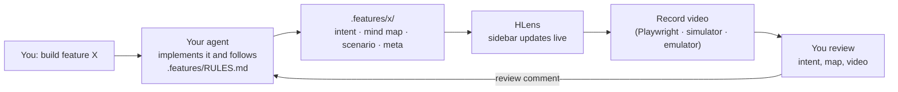

<div align="center">


# HLens

**Stop reading agent-written code line by line.**<br/>
Review every feature by its *intent*, a *mind map* of its implementation, and a *recorded demo video* — right from the VS Code sidebar.

[](LICENSE)
[](https://code.visualstudio.com/)
[](#video-recording)
[](package.json)

</div>

---

## Why

AI coding agents ship features faster than anyone can read the diffs. HLens gives each feature a small, always-current dossier that an agent writes and you review:

| Tab | What you see | Source file |
|---|---|---|
| **Intent** | Why the feature exists, the user flow, the rules that are really in the code | `intent.md` |
| **Implementation** | A zoomable mind map of screens, APIs, state and impact. Click a node to open the file. | `implementation.mm.md` |
| **Demo** | A video of the feature running, recorded from a scenario script | `scenario.spec.ts` / `scenario.dart` |

The sidebar lists every feature as a tree with its status (**Draft → Needs review → Approved**) and whether it has review comments.

## How it works



- **Rules live in your repo.** `.features/RULES.md` tells any coding agent how to write and update feature docs. The extension adds a one-line reference to `CLAUDE.md` and `AGENTS.md`.
- **Features appear as you build them.** Nothing is scanned retroactively unless you ask for it.
- **Nothing is hidden.** The extension reads plain files from `.features/` and never handles logins or tokens. Agent-powered steps run your own `claude` CLI in a visible terminal.

## Install

HLens is not on the Marketplace yet. Install it from a release or build it yourself.

**From a `.vsix`**

1. Download the latest `hlens-*.vsix` from [Releases](https://github.com/hov-i/hlens/releases).
2. In VS Code run **Extensions: Install from VSIX…** and pick the file.

**From source**

```bash
git clone https://github.com/hov-i/hlens.git
cd hlens
npm ci
npm run package          # produces hlens-<version>.vsix
code --install-extension hlens-*.vsix
```

## Quick start

1. Open your project. HLens asks whether to **set it up** — this adds `.features/RULES.md` and a one-line reference in `CLAUDE.md` / `AGENTS.md`. Your code is untouched.
2. Ask your agent for a feature, e.g. *"build the password reset flow"*. Following the rules, it creates `.features/password-reset/` alongside the code.
3. Open the **HLens** icon in the activity bar, pick the feature, and read its **Intent** and **Implementation** tabs.
4. Click **Record video** in the **Demo** tab to run the scenario and watch it.
5. Leave a `.review.md` in the feature folder to send feedback; the agent applies it and deletes the file.

Already have a codebase? Use **HLens: Generate feature list from existing code** (the ✨ button) to catalog it once. This is optional and uses your own Claude Code.

## Video recording

The recorder is chosen by `platform` in `.features/config.json`. If omitted it is detected: a `pubspec.yaml` with Flutter means mobile (`ios` on macOS, `android` elsewhere), anything else is `web`.

| `platform` | Scenario file | How it is recorded |
|---|---|---|
| `web` *(default)* | `scenario.spec.ts` ([Playwright](https://playwright.dev)) | Starts `devCommand`, runs the scenario with video on. Offers to install Playwright if it is missing. |
| `ios` | `scenario.dart` (Flutter `integration_test`) | Records the booted simulator with `xcrun simctl io recordVideo` while `flutter test` runs. |
| `android` | `scenario.dart` (Flutter `integration_test`) | Records the emulator with `adb screenrecord` (3 minute device limit) while `flutter test` runs. |

Videos are saved to `.features/<feature>/.out/` and are git-ignored. If the scenario fails, the video still shows the run up to the failure, so you can see where it broke.

> **Status:** iOS recording has been run on a simulator, but only lightly. Web recording uses Playwright's standard video flow and Android recording (`adb screenrecord`) has not been tested on a real device yet. Please open an issue if something misbehaves.

### Configuration

`.features/config.json`:

```jsonc
{
  "platform": "web",                       // "web" | "ios" | "android" (optional, auto-detected)
  "baseUrl": "http://localhost:3000",      // web: app URL
  "devCommand": "npm run dev",             // web: command that starts the server
  "auth": "./auth.setup.ts",               // web: Playwright login setup · mobile: Dart signIn helper
  "testCommand": "flutter test {scenario} -d {device}", // mobile: placeholders {scenario} {device} {id}
  "device": "booted"                       // mobile: simulator/emulator id (default: the booted one)
}
```

For mobile, Flutter only treats files under `integration_test/` as on-device tests, so HLens copies the scenario there for the duration of the run and removes it afterwards. Boot your simulator or emulator before recording.

## Feature folder format

```
.features/
  config.json            project-wide settings
  RULES.md               rules your agent follows
  login/                 feature id = path (kebab-case, up to 3 levels)
    intent.md            Purpose · User flow · Decisions
    implementation.mm.md Markmap: Screens · API · State · Impact
    scenario.spec.ts     web scenario (or scenario.dart for ios/android)
    meta.json            name, status, owned files
    social/              sub-feature (login/social)
```

A folder is a feature only if it contains `meta.json`. See [`templates/kit/RULES.md`](templates/kit/RULES.md) for the complete rules.

## Commands and settings

| Command | What it does |
|---|---|
| **HLens: Set up** | Adds `.features/RULES.md` and the one-line `CLAUDE.md` / `AGENTS.md` reference. |
| **HLens: Record video** | Records the selected feature (also the 📹 icon in the sidebar and the button in the **Demo** tab). |
| **HLens: Generate feature list from existing code** | Runs `claude` in a terminal to catalog an existing codebase. |
| **Refresh** | Reloads the feature tree. |

| Setting | Default | Description |
|---|---|---|
| `hlens.autoSetup` | `false` | Set up HLens without asking when a project has not been set up. |

## Requirements

- VS Code 1.90 or newer
- For agent-powered steps: the [Claude Code](https://code.claude.com/docs) CLI, installed and signed in
- For web recording: Node.js (Playwright is installed on demand)
- For iOS recording: macOS with Xcode and a booted simulator, plus Flutter
- For Android recording: `adb`, a connected emulator or device, plus Flutter

## Development

```bash
npm ci
npm run typecheck        # tsc --noEmit
npm run build            # bundles dist/extension.js and dist/webview.js
npm run package          # builds the .vsix
```

```
src/
  extension.ts     activation, commands, file watcher
  features.ts      .features scanning, config and platform detection
  tree.ts          sidebar tree
  panel.ts         detail webview (intent · mind map · demo)
  record.ts        web / iOS / Android recording
  generate.ts      first-run setup prompt and Claude Code hand-offs
  webview/main.ts  webview UI (Markmap, video)
templates/         files copied into your project
```

## Contributing

Issues and pull requests are welcome. For larger changes, please open an issue first to discuss the direction.

## License

[MIT](LICENSE) © hovi
